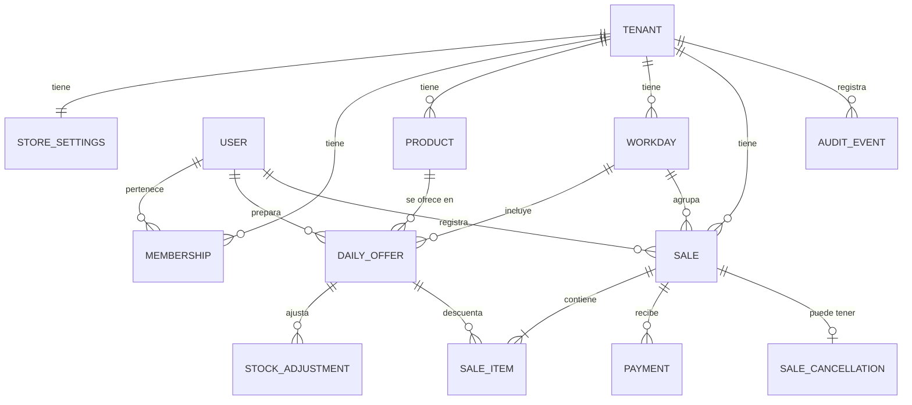

# Dominio

Modelo conceptual y reglas de negocio. No es un esquema físico; las tablas, índices y tipos concretos se definen en migraciones, fase por fase. Los requisitos están en [requerimientos.md](requerimientos.md) y las decisiones en [decisiones.md](decisiones.md).

## Convenciones

- Todo recurso de negocio pertenece a un tenant (la tienda) y toda consulta lo aplica.
- Dinero: decimal exacto de 2 posiciones. Cantidades: decimal de 3 posiciones; hoy el dominio rechaza fracciones para productos que no las admiten.
- Las fechas y horas críticas las genera el backend. La fecha de negocio (`business_date`) es la fecha local de la tienda en el momento de la operación.
- Moneda `MXN` y zona horaria `America/Mexico_City` viven en la configuración de la tienda.

## Relaciones

## Entidades

| Entidad | Campos de negocio | Notas |
|---|---|---|
| Tenant | nombre, estado (activo/desactivado) | Una tienda. |
| StoreSettings | moneda, zona horaria, horario de jornada (por omisión 08:00 a 16:00), días de operación (por omisión lunes a viernes) | 1 a 1 con Tenant. Editable por el propietario. |
| User | identificador de identidad externa, correo, nombre para mostrar (fase 10, opcional, máximo 80) | La contraseña la gestiona el proveedor de identidad; la app nunca la guarda ni la registra. |
| Membership | tenant, usuario, rol (`owner` o, desde la fase 10, `seller`), estado (`active`/`disabled`), quién lo dio de alta | Una persona pertenece a una sola tienda. Cada tienda tiene exactamente un `owner` y hasta 10 `seller` (T101, T106). Un usuario dado de baja (`disabled`) no puede operar. |
| Product | nombre, descripción, categoría, código interno, unidad (por omisión `pieza`), admite fracciones (falso), precio de venta, costo, notas, activo, versión, creado y modificado el | Desactivar no borra historial. El costo es obligatorio (puede ser 0). El código interno es único por tienda. La versión sube en cada cambio y evita ediciones simultáneas (T21). |
| Workday (jornada) | fecha de negocio, hora de inicio, hora de fin | Única por (tenant, fecha). Se crea al agregar el primer producto y copia el horario de la configuración; el horario se puede ajustar por día. Solo se modifican jornadas de hoy en adelante; las pasadas son de consulta. Sin cierre. |
| DailyOffer | jornada, usuario (fase 10), producto, cantidad inicial | Único por (jornada, usuario, producto). Cada persona prepara su propia disponibilidad (T105); en una tienda sin vendedores solo existen las del `owner`, como antes. La cantidad inicial no se edita; crece solo con ajustes. Solo productos activos de la misma tienda. |
| StockAdjustment | disponibilidad diaria, incremento (> 0), motivo, usuario, fecha | Solo incrementos (B9). |
| Sale | folio consecutivo por tenant, jornada, cliente/referencia, nota, estado (`active`/`cancelled`), total, creada el, creada por, llave de idempotencia, liquidada el | El folio es legible (`V-0043`, RF-049). Nace en la jornada de hoy. Una venta confirmada no se edita ni se borra (la base lo impide); solo puede pasar a cancelada. La fecha de liquidación llega con los pagos (fase 5). |
| SaleItem | venta, posición, disponibilidad diaria, producto, nombre del producto en ese momento, cantidad, precio unitario, costo unitario, subtotal | Congela precio, costo y nombre (RF-044, RF-045). Un producto aparece una sola vez por venta. Subtotal = cantidad × precio, redondeado a centavos. |
| Payment | venta, método (`cash`/`transfer`), monto, fecha, operación, llave de idempotencia, estado (`valid`/`voided`), motivo, fecha y usuario de la anulación, usuario | Un pago mixto son varios renglones de la misma operación (uno por método). El método es solo informativo (B16). Un pago no se borra ni se edita: solo se anula. |
| SaleCancellation | venta, motivo, fecha, usuario, inventario restituido (sí/no) | Se conserva siempre y no se edita ni se borra. Una venta tiene como máximo una. Una venta cancelada no se reactiva. |
| AuditEvent | entidad, acción, usuario, fecha, datos no sensibles | Se escribe en la misma transacción que el cambio. |

## Valores derivados

- `total` = suma de subtotales de la venta.
- `pagado` = suma de pagos `valid`.
- `saldo` = `total` − `pagado`; una venta cancelada tiene saldo 0 (ya no se cobra).
- Estado de cobro: `cancelled` si la venta está cancelada; si no, `paid` si `saldo` = 0 (también una venta de total cero), `partial` si 0 < `pagado` < `total`, y `pending` si `pagado` = 0. La interfaz agrupa `pending` y `partial` como "Pendiente".
- Fecha de liquidación (`settled_at`): cuándo el saldo llegó a 0; se borra si una anulación vuelve a dejar saldo.
- Vendido de un producto en un día = unidades en ventas vigentes más las de ventas canceladas cuyo inventario no se restituyó (B13).
- Disponible de un producto en un día = cantidad inicial + ajustes − vendido, **por persona** (fase 10): cada `DailyOffer` pertenece a un usuario y solo ese usuario la descuenta al vender.
- Por devolver fuera del sistema de una venta cancelada = pagos `valid` de esa venta (B14).

## Invariantes (cada una lleva prueba automatizada)

1. Ninguna consulta ni escritura cruza tenants.
2. Disponible ≥ 0 siempre; no se vende más de lo disponible.
3. Una venta tiene al menos un renglón y cantidades > 0.
4. `0 ≤ pagado ≤ total` en ventas activas; no hay sobrepago.
5. Una venta es `paid` solo si el saldo es 0.
6. Precio, costo y nombre del renglón no cambian si se edita el catálogo.
7. Una venta confirmada nunca se borra ni se edita.
8. Una operación repetida con la misma llave de idempotencia no duplica efectos.
9. Venta e inventario se confirman o se revierten juntos.
10. (Fase 10) Toda operación verifica el permiso del rol en el caso de uso; una ruta privada sin permiso declarado no arranca.
11. (Fase 10) Un `seller` solo ve y opera (incluido cancelar y anular) las ventas y pagos que él registró; un recurso de otro vendedor responde 404.
12. (Fase 10) Una venta solo descuenta la disponibilidad de quien la registra, y ese vendedor solo vende lo que preparó.
13. (Fase 10) Un usuario dado de baja no puede operar desde su siguiente petición, aunque su token siga vigente; su historial se conserva.
14. (Fase 10) La suma de las filas del reporte por vendedor cuadra con el reporte general.

## Flujos

### Preparar el día
1. El usuario (el propietario o, desde la fase 10, cada vendedor) elige la fecha (por omisión hoy) y selecciona productos activos con su cantidad inicial (≥ 0).
2. Si no existe, se crea la `Workday` de esa fecha con el horario de la tienda. Se guarda una `DailyOffer` por producto **a nombre de quien prepara**; un producto ya agregado por esa persona no se duplica (se dirige al registro existente). Otra persona puede preparar el mismo producto el mismo día con su propia cantidad.
3. Para aumentar la cantidad se crea un `StockAdjustment`; nunca se baja. Quitar un producto del día solo es posible si no tiene ventas (y se vuelve a agregar si hubo un error).

### Crear venta
1. Entrada: renglones (producto, cantidad), cliente/referencia y nota opcionales, pago opcional y `Idempotency-Key`.
2. El backend valida el tenant, que cada producto esté en la disponibilidad de hoy **de quien vende** y que la cantidad sea válida.
3. En una transacción: bloquea los productos del día de quien vende y comprueba que haya existencias (vendido se calcula con las ventas no canceladas); crea la venta con precio, costo y nombre congelados y el siguiente folio; registra el pago si viene (fase 5); escribe auditoría.
4. Si falta inventario, se rechaza todo e indica el producto afectado. Un reintento con la misma llave devuelve la venta ya creada.

### Registrar pago
1. Entrada: renglones de pago (método, monto) y `Idempotency-Key`. Un pago mixto trae efectivo y transferencia en la misma operación.
2. Se valida que la venta sea del tenant, esté activa y que la suma no exceda el saldo.
3. Se crean los pagos con fecha del backend. Si el saldo llega a 0, se registra la fecha de liquidación.

### Anular pago
1. Requiere motivo y que la venta esté activa.
2. El pago pasa a `voided` y se conserva. El saldo y el estado se recalculan; si la venta estaba pagada, se limpia la fecha de liquidación y el evento queda en auditoría.

### Cancelar venta
1. Requiere confirmación (interfaz) y motivo; no se repite sobre una venta ya cancelada (409).
2. En una transacción: bloquea la venta, la marca `cancelled`, guarda la cancelación y la auditoría.
3. Si la venta es de hoy, se restituyen las unidades a la disponibilidad. Si es de un día anterior, no se restituye, esas unidades siguen contando como vendidas de su día y se registra (B13).
4. Los pagos se conservan y se muestran como "por devolver fuera del sistema" (`refundDue`). La interfaz advierte que cualquier devolución de dinero se hace fuera del sistema.
5. La venta cancelada ya no admite pagos ni anulaciones, y sale de pendientes.

### Alta de vendedor (fase 10)
1. Solo el `owner`. Entrada: nombre, correo y contraseña inicial.
2. Se valida el correo (único en todo el sistema), la política de contraseña y el tope de 10 vendedores.
3. Se crea la cuenta en el proveedor de identidad; luego, en una transacción, `User`, `Membership` (`seller`, `active`) y auditoría. Si la base falla, se borra la cuenta creada.
4. La contraseña no se guarda ni se registra. Con ese correo y esa contraseña el vendedor inicia sesión. Por ahora no se puede cambiar desde la app (T108).

### Baja y reactivación (fase 10)
1. Solo el `owner`. La baja marca la membresía `disabled`, deshabilita la cuenta en el proveedor y cierra sus sesiones.
2. Desde su siguiente petición el usuario recibe un rechazo; sus ventas, pagos y disponibilidades se conservan.
3. La reactivación revierte el estado y habilita la cuenta. Restablecer una contraseña olvidada se hace fuera de la app, en CloudShell (T108).

## Definiciones de métricas

| Métrica | Definición |
|---|---|
| Ventas | Suma del total de ventas no canceladas con fecha de negocio dentro del periodo. |
| Número de ventas | Cantidad de esas ventas. |
| Ticket promedio | Ventas ÷ número de ventas. |
| Unidades vendidas | Suma de cantidades de esas ventas. |
| Cobrado | Suma de pagos `valid` con fecha de pago dentro del periodo (día completo en la zona de la tienda), de ventas no canceladas. Puede incluir pagos de ventas de periodos anteriores. |
| Cobrado por método | Lo mismo, separado en efectivo y transferencia. |
| Pendiente del periodo | Saldo actual de las ventas del periodo. |
| Pendiente total | Saldo actual de todas las ventas activas del tenant (dashboard y lista de pendientes). |
| Costo de productos vendidos | Suma de cantidad × costo unitario congelado de las ventas del periodo; cada renglón se redondea a centavos con la mitad hacia arriba. |
| Utilidad bruta | Ventas − costo de productos vendidos. Si es negativa, se muestra como pérdida bruta. |
| Margen bruto | Utilidad bruta ÷ ventas, en porcentaje con 2 decimales, cuando ventas > 0; si no, nulo. |
| Productos más vendidos | Los 10 primeros por unidades vendidas en el periodo (desempate por importe), solo de ventas no canceladas. |
| Ventas canceladas | Número y total de las ventas canceladas con fecha de negocio dentro del periodo. Se muestran aparte y no entran en ninguna métrica anterior. |
| Por devolver fuera del sistema | Pagos vigentes de las ventas canceladas del periodo (B14). |
| Dashboard (hoy) | Ventas, número de ventas, cobrado (por método) y utilidad bruta estimada del día de hoy; pendiente total (número y monto) de todas las ventas vigentes con saldo, de cualquier día. |

### Métricas por vendedor (fase 10)

Las definiciones de arriba se aplican acotadas a las ventas de una persona (`sales.created_by`), con la fecha de negocio de la venta. Las ventas del `owner` forman una fila más.

| Métrica | Definición |
|---|---|
| Ventas, número, ticket promedio, unidades, costo, utilidad bruta, margen bruto | Las mismas de la tabla anterior, solo con las ventas no canceladas de ese vendedor en el periodo. |
| Cobrado y cobrado por método | Pagos `valid` con fecha de pago dentro del periodo sobre ventas no canceladas de ese vendedor (el mismo criterio que el reporte general, para que la suma cuadre). Informativo: no es un corte de caja. |
| Pendiente del periodo | Saldo actual de las ventas de ese vendedor dentro del periodo. |
| Pendiente por cobrar (lo que se le debe) | Suma del saldo de todas las ventas vigentes de ese vendedor, **de cualquier día**, y número de ventas con saldo. No depende del periodo. La suma de los vendedores es el pendiente total. |
| Participación | Ventas del vendedor ÷ ventas de la tienda en el periodo, en porcentaje con 2 decimales, cuando ventas > 0. |
| Ventas canceladas, por devolver | Número, total y pagos vigentes de las canceladas de ese vendedor en el periodo, aparte. |
| Antigüedad del pendiente (recomendada) | Pendiente por cobrar agrupado por días desde la fecha de negocio de la venta: 0 a 7, 8 a 30 y más de 30. |
| Tasa de cancelación | Ventas canceladas ÷ todas las ventas registradas del vendedor en el periodo (vigentes y canceladas), en porcentaje con 2 decimales; nulo si no hubo ventas. |
| Periodo anterior (comparativo) | El mes anterior si el periodo es un mes, la semana anterior (lunes a domingo) si es una semana y, en otro caso, un periodo de la misma duración inmediatamente antes. |
| Serie diaria | Ventas vigentes y número de ventas por día del periodo, con ceros en los días sin ventas. |
| Aprovechamiento del día (recomendada) | Unidades preparadas (inicial más ajustes) contra vendidas en el periodo, porcentaje vendido y productos agotados. |

El reporte de un vendedor es este mismo cálculo acotado a él, de modo que su utilidad coincide con su fila en el reporte del propietario. El corte de efectivo por entregar no existe en el sistema.

La utilidad bruta no incluye gastos ni impuestos y no es utilidad neta; así se etiqueta en la interfaz.

## Semanas y periodos

Los cortes diarios, mensuales y de rango usan la zona horaria de la tienda. La semana va de lunes a domingo y los días de operación configurados solo determinan qué días se muestran destacados (B10); cualquier día admite jornada y ventas.

El horario de la jornada es informativo: una venta fuera de horario se permite con un aviso (B15). El horario sale de la configuración de cada tienda y puede ajustarse en una jornada concreta.
