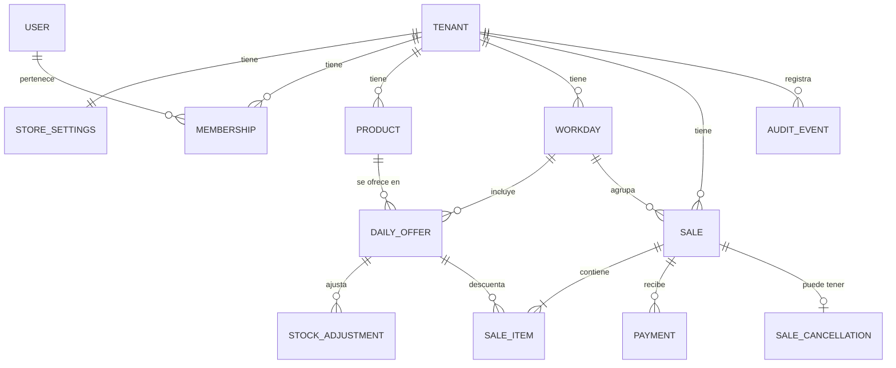

# Dominio

Modelo conceptual y reglas de negocio. No es un esquema físico; las tablas, índices y tipos concretos se definen en migraciones, fase por fase. Los requisitos están en [requerimientos.md](requerimientos.md) y las decisiones en [decisiones.md](decisiones.md).

## Convenciones

- Todo recurso de negocio pertenece a un tenant (la tienda) y toda consulta lo aplica.
- Dinero: decimal exacto de 2 posiciones. Cantidades: decimal de 3 posiciones; hoy el dominio rechaza fracciones para productos que no las admiten.
- Las fechas y horas críticas las genera el backend. La fecha de negocio (`business_date`) es la fecha local de la tienda en el momento de la operación.
- Moneda `MXN` y zona horaria `America/Mexico_City` viven en la configuración de la tienda.

## Relaciones

## Entidades

| Entidad | Campos de negocio | Notas |
|---|---|---|
| Tenant | nombre, estado (activo/desactivado) | Una tienda. |
| StoreSettings | moneda, zona horaria, horario de jornada (por omisión 08:00 a 16:00), días de operación (por omisión lunes a viernes) | 1 a 1 con Tenant. Editable por el propietario. |
| User | identificador de identidad externa, correo | La contraseña la gestiona el proveedor de identidad. |
| Membership | tenant, usuario, rol (`owner`) | Permite agregar cajeros después sin cambiar el modelo. |
| Product | nombre, descripción, categoría, código interno, unidad (por omisión `pieza`), admite fracciones (falso), precio de venta, costo, notas, activo, versión, creado y modificado el | Desactivar no borra historial. El costo es obligatorio (puede ser 0). El código interno es único por tienda. La versión sube en cada cambio y evita ediciones simultáneas (T21). |
| Workday (jornada) | fecha de negocio, hora de inicio, hora de fin | Única por (tenant, fecha). Se crea al agregar el primer producto y copia el horario de la configuración; el horario se puede ajustar por día. Solo se modifican jornadas de hoy en adelante; las pasadas son de consulta. Sin cierre. |
| DailyOffer | jornada, producto, cantidad inicial | Único por (jornada, producto). La cantidad inicial no se edita; crece solo con ajustes. Solo productos activos de la misma tienda. |
| StockAdjustment | disponibilidad diaria, incremento (> 0), motivo, usuario, fecha | Solo incrementos (B9). |
| Sale | folio consecutivo por tenant, jornada, cliente/referencia, nota, estado (`active`/`cancelled`), total, creada el, creada por, llave de idempotencia, liquidada el | El folio es legible (`V-0043`, RF-049). Nace en la jornada de hoy. Una venta confirmada no se edita ni se borra (la base lo impide); solo puede pasar a cancelada. La fecha de liquidación llega con los pagos (fase 5). |
| SaleItem | venta, posición, disponibilidad diaria, producto, nombre del producto en ese momento, cantidad, precio unitario, costo unitario, subtotal | Congela precio, costo y nombre (RF-044, RF-045). Un producto aparece una sola vez por venta. Subtotal = cantidad × precio, redondeado a centavos. |
| Payment | venta, método (`cash`/`transfer`), monto, fecha, operación, llave de idempotencia, estado (`valid`/`voided`), motivo, fecha y usuario de la anulación, usuario | Un pago mixto son varios renglones de la misma operación (uno por método). El método es solo informativo (B16). Un pago no se borra ni se edita: solo se anula. |
| SaleCancellation | venta, motivo, fecha, usuario, inventario restituido (sí/no) | Se conserva siempre y no se edita ni se borra. Una venta tiene como máximo una. Una venta cancelada no se reactiva. |
| AuditEvent | entidad, acción, usuario, fecha, datos no sensibles | Se escribe en la misma transacción que el cambio. |

## Valores derivados

- `total` = suma de subtotales de la venta.
- `pagado` = suma de pagos `valid`.
- `saldo` = `total` − `pagado`; una venta cancelada tiene saldo 0 (ya no se cobra).
- Estado de cobro: `cancelled` si la venta está cancelada; si no, `paid` si `saldo` = 0 (también una venta de total cero), `partial` si 0 < `pagado` < `total`, y `pending` si `pagado` = 0. La interfaz agrupa `pending` y `partial` como "Pendiente".
- Fecha de liquidación (`settled_at`): cuándo el saldo llegó a 0; se borra si una anulación vuelve a dejar saldo.
- Vendido de un producto en un día = unidades en ventas vigentes más las de ventas canceladas cuyo inventario no se restituyó (B13).
- Disponible de un producto en un día = cantidad inicial + ajustes − vendido.
- Por devolver fuera del sistema de una venta cancelada = pagos `valid` de esa venta (B14).

## Invariantes (cada una lleva prueba automatizada)

1. Ninguna consulta ni escritura cruza tenants.
2. Disponible ≥ 0 siempre; no se vende más de lo disponible.
3. Una venta tiene al menos un renglón y cantidades > 0.
4. `0 ≤ pagado ≤ total` en ventas activas; no hay sobrepago.
5. Una venta es `paid` solo si el saldo es 0.
6. Precio, costo y nombre del renglón no cambian si se edita el catálogo.
7. Una venta confirmada nunca se borra ni se edita.
8. Una operación repetida con la misma llave de idempotencia no duplica efectos.
9. Venta e inventario se confirman o se revierten juntos.

## Flujos

### Preparar el día
1. El propietario elige la fecha (por omisión hoy) y selecciona productos activos con su cantidad inicial (≥ 0).
2. Si no existe, se crea la `Workday` de esa fecha con el horario de la tienda. Se guarda una `DailyOffer` por producto; un producto ya agregado no se duplica (se dirige al registro existente).
3. Para aumentar la cantidad se crea un `StockAdjustment`; nunca se baja. Quitar un producto del día solo es posible si no tiene ventas (y se vuelve a agregar si hubo un error).

### Crear venta
1. Entrada: renglones (producto, cantidad), cliente/referencia y nota opcionales, pago opcional y `Idempotency-Key`.
2. El backend valida el tenant, que cada producto esté en la disponibilidad de hoy y que la cantidad sea válida.
3. En una transacción: bloquea los productos del día y comprueba que haya existencias (vendido se calcula con las ventas no canceladas); crea la venta con precio, costo y nombre congelados y el siguiente folio; registra el pago si viene (fase 5); escribe auditoría.
4. Si falta inventario, se rechaza todo e indica el producto afectado. Un reintento con la misma llave devuelve la venta ya creada.

### Registrar pago
1. Entrada: renglones de pago (método, monto) y `Idempotency-Key`. Un pago mixto trae efectivo y transferencia en la misma operación.
2. Se valida que la venta sea del tenant, esté activa y que la suma no exceda el saldo.
3. Se crean los pagos con fecha del backend. Si el saldo llega a 0, se registra la fecha de liquidación.

### Anular pago
1. Requiere motivo y que la venta esté activa.
2. El pago pasa a `voided` y se conserva. El saldo y el estado se recalculan; si la venta estaba pagada, se limpia la fecha de liquidación y el evento queda en auditoría.

### Cancelar venta
1. Requiere confirmación (interfaz) y motivo; no se repite sobre una venta ya cancelada (409).
2. En una transacción: bloquea la venta, la marca `cancelled`, guarda la cancelación y la auditoría.
3. Si la venta es de hoy, se restituyen las unidades a la disponibilidad. Si es de un día anterior, no se restituye, esas unidades siguen contando como vendidas de su día y se registra (B13).
4. Los pagos se conservan y se muestran como "por devolver fuera del sistema" (`refundDue`). La interfaz advierte que cualquier devolución de dinero se hace fuera del sistema.
5. La venta cancelada ya no admite pagos ni anulaciones, y sale de pendientes.

## Definiciones de métricas

| Métrica | Definición |
|---|---|
| Ventas | Suma del total de ventas no canceladas con fecha de negocio dentro del periodo. |
| Número de ventas | Cantidad de esas ventas. |
| Ticket promedio | Ventas ÷ número de ventas. |
| Unidades vendidas | Suma de cantidades de esas ventas. |
| Cobrado | Suma de pagos `valid` con fecha de pago dentro del periodo, de ventas no canceladas. Puede incluir pagos de ventas de periodos anteriores. |
| Cobrado por método | Lo mismo, separado en efectivo y transferencia. |
| Pendiente del periodo | Saldo actual de las ventas del periodo. |
| Pendiente total | Saldo actual de todas las ventas activas del tenant (dashboard y lista de pendientes). |
| Costo de productos vendidos | Suma de cantidad × costo unitario congelado de las ventas del periodo. |
| Utilidad bruta | Ventas − costo de productos vendidos. Si es negativa, se muestra como pérdida bruta. |
| Margen bruto | Utilidad bruta ÷ ventas, cuando ventas > 0. |
| Ventas canceladas | Se muestran aparte y no entran en ninguna métrica anterior. |
| Por devolver fuera del sistema | Pagos vigentes de ventas canceladas (B14). |

La utilidad bruta no incluye gastos ni impuestos y no es utilidad neta; así se etiqueta en la interfaz.

## Semanas y periodos

Los cortes diarios, mensuales y de rango usan la zona horaria de la tienda. La semana va de lunes a domingo y los días de operación configurados solo determinan qué días se muestran destacados (B10); cualquier día admite jornada y ventas.

El horario de la jornada es informativo: una venta fuera de horario se permite con un aviso (B15). El horario sale de la configuración de cada tienda y puede ajustarse en una jornada concreta.
