# Manual de usuario

Aplicación para registrar ventas, cobros, inventario del día y reportes de tu negocio, desde el teléfono.

Este manual tiene tres partes: lo que todos hacen, la guía del propietario y la guía del vendedor. Las capturas son de una tienda de ejemplo, con datos inventados.

## Cómo usar este manual

**Quién lee qué**

| Si eres… | Lee |
|---|---|
| Propietario | La parte 1 y la parte 2. La parte 3 te sirve para saber qué ve tu vendedor. |
| Vendedor | La parte 1 y la parte 3. |

**Cómo leer las capturas**

- Un recuadro rojo señala el botón o el campo que tienes que tocar o mirar.
- Las pantallas se ven así en un teléfono. En una tableta o computadora son iguales, pero más anchas.
- Los nombres de botones y pantallas aparecen en **negritas**, tal como se ven en la aplicación.

**Lo que necesitas**

- Un teléfono (o computadora) con internet y un navegador actual, como Safari o Chrome.
- La dirección de la aplicación y tu correo y tu contraseña. Si eres propietario, te los dieron al crear tu tienda. Si eres vendedor, te los da el propietario.
- La aplicación **solo funciona con internet**. Si se va la señal, no se guarda nada hasta que regrese.

**Para tenerla a la mano.** Puedes guardar la dirección en la pantalla de inicio del teléfono, como si fuera una aplicación. En iPhone: abre la dirección en Safari, toca el botón de compartir y elige agregarla a la pantalla de inicio. En Android: abre la dirección en Chrome, toca el menú de los tres puntos y elige agregarla a la pantalla de inicio. El nombre exacto de los botones cambia según el teléfono. Esto lo hace tu navegador; la aplicación no necesita instalarse.

---

# Parte 1. Para todos

Esta parte sirve igual para el propietario y para los vendedores. Cuando algo cambia según el rol, se avisa.

## 1. Iniciar sesión

1. Abre la dirección de la aplicación. Escribe tu **correo electrónico** y tu **contraseña**, y toca **Iniciar sesión**.

   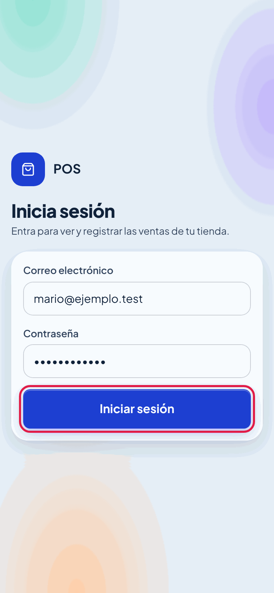

2. Si el correo o la contraseña no coinciden, aparece el aviso **Correo o contraseña incorrectos.** Revisa que no haya espacios de más ni mayúsculas cambiadas e inténtalo de nuevo.

   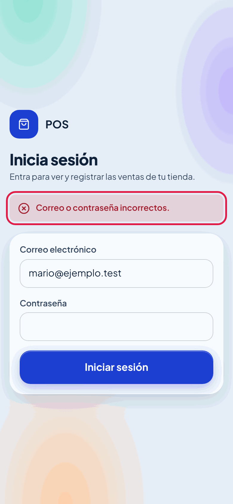

Si olvidaste tu contraseña, por ahora la aplicación no permite cambiarla: pídele ayuda al propietario de la tienda (si eres vendedor) o a quien te dio de alta (si eres propietario).

## 2. Conocer la pantalla

La pantalla **Hoy** es tu punto de partida. Muestra cómo va el día de un vistazo.

Mientras no prepares el día (siguiente sección), arriba aparece un aviso amarillo con el botón **Preparar día**. Así se ve la misma pantalla con ventas:

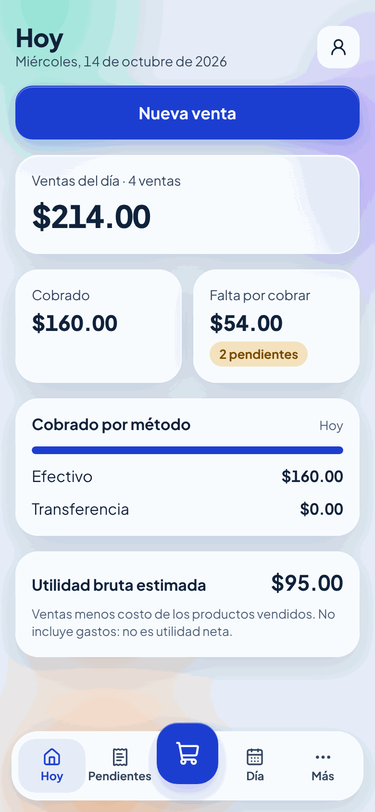

- **Ventas del día:** cuántas ventas llevas y cuánto suman.
- **Cobrado:** el dinero que ya recibiste hoy.
- **Falta por cobrar:** lo que te deben de las ventas pendientes. Al tocarlo vas a **Pendientes**.
- **Cobrado por método:** cuánto fue en efectivo y cuánto en transferencia.
- **Utilidad bruta estimada:** ventas menos el costo de los productos vendidos. **No incluye gastos**, así que no es la utilidad neta.

Abajo siempre tienes la barra de navegación: **Hoy**, **Pendientes**, el carrito grande para **Nueva venta**, **Día** (preparar y consultar el inventario) y **Más** (todo lo demás). Arriba a la derecha, el icono de persona abre tu **Perfil**.

## 3. Preparar el día

Antes de vender, dile a la aplicación qué productos tienes hoy y cuántas piezas de cada uno. Eso es **preparar el día**. Si no lo haces, no podrás vender.

1. Toca **Día** en la barra de abajo. Si todavía no hay nada, verás **Este día todavía no está preparado**. Toca **Agregar producto**.

   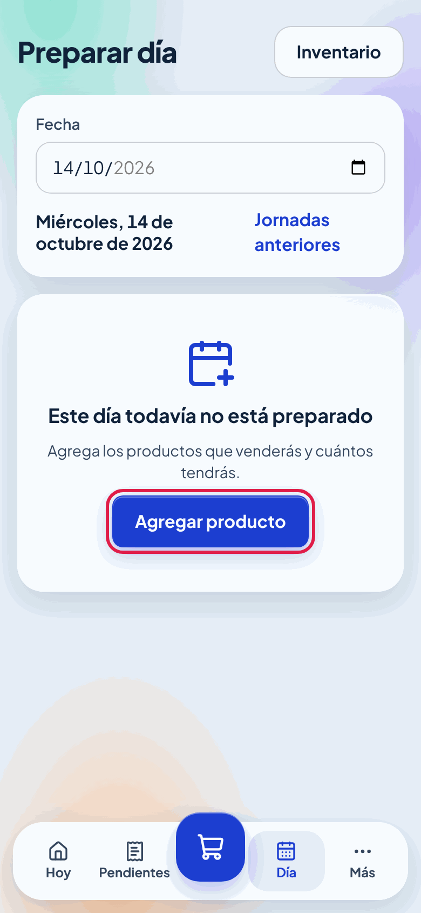

2. Se abre una lista con los productos del catálogo. Puedes buscar por nombre. Toca el producto que quieres agregar.

   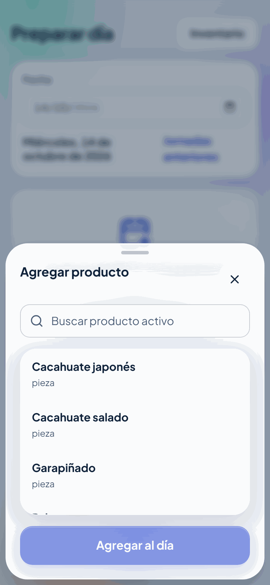

3. Escribe la **Cantidad inicial**: cuántas piezas tienes para hoy. Toca **Agregar al día**.

   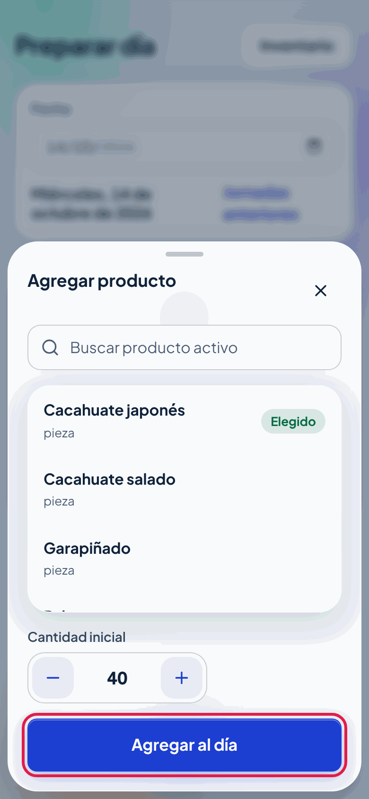

4. Repite con cada producto que vayas a vender. Cada producto del día muestra tres números: **Inicial** (con cuánto empezaste), **Vendido** y **Disponible** (lo que queda).

   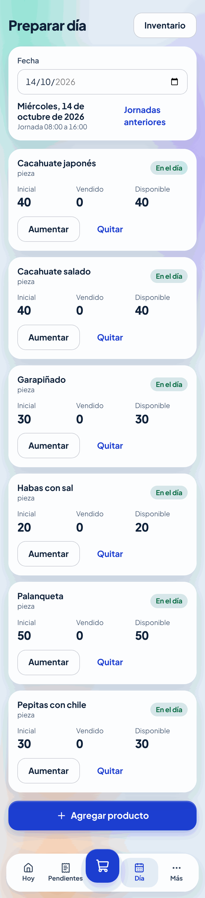

**Si preparaste de menos.** Toca **Aumentar** en el producto, escribe la **Nueva cantidad** (solo se puede subir, no bajar) y el **Motivo**, y toca **Guardar aumento**. El motivo queda registrado.

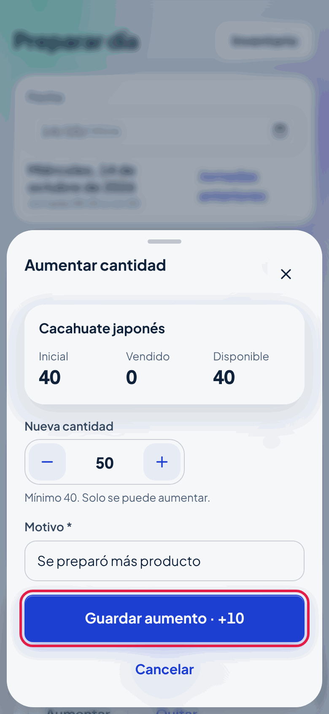

**Si agregaste un producto por error.** Toca **Quitar** y confirma con **Quitar del día**. Puedes volver a agregarlo cuando quieras.

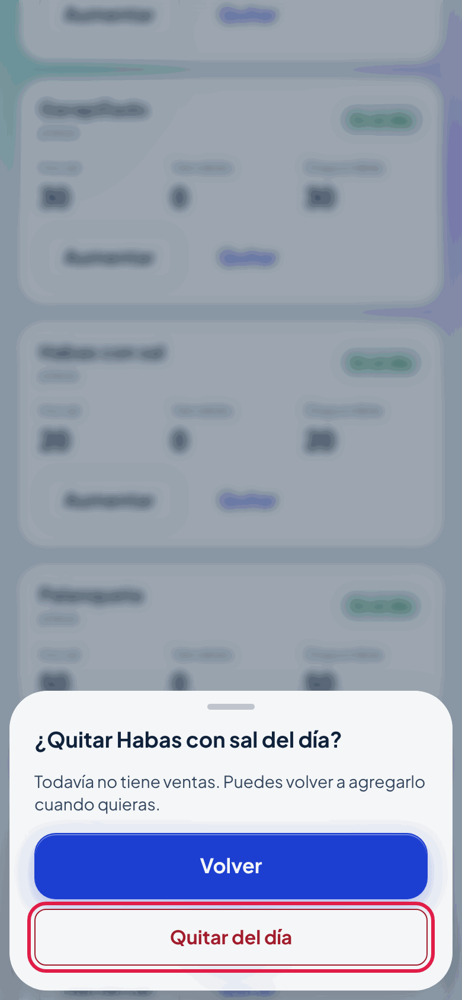

Un producto que ya tiene ventas **no se puede quitar**: la aplicación te lo explica y se queda en el día.

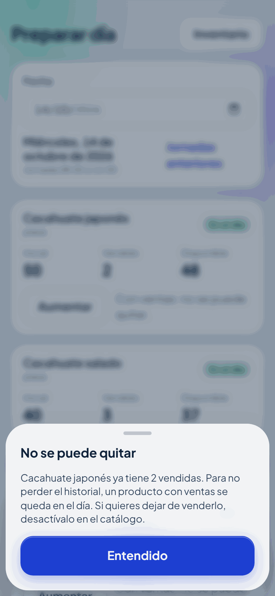

**Para consultar el inventario.** En el día de hoy, **Inventario** (arriba a la derecha de **Preparar día**) muestra cuánto se ha vendido de cada producto y cuánto queda, con una barra de avance. Es solo de consulta.

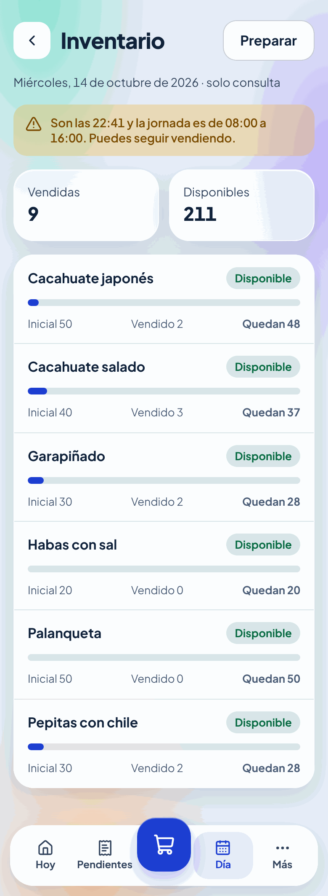

**Jornadas anteriores.** En **Día** → **Jornadas anteriores** consultas los días que ya terminaron. Mientras no haya días terminados, aparece vacía. Los días pasados son solo de consulta.

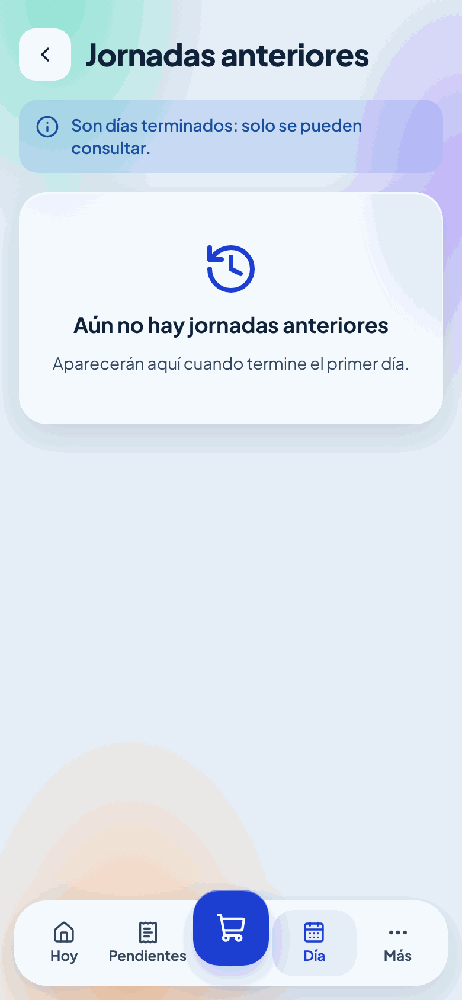

> **El horario de la jornada.** Verás avisos como "Fuera del horario de la jornada". Son solo informativos: **nunca te impiden vender**.

## 4. Vender

1. Toca el carrito grande de la barra de abajo (o **Nueva venta** en **Hoy**). Verás los productos que preparaste, con su precio y cuántas piezas **quedan**. Puedes buscar por nombre.

   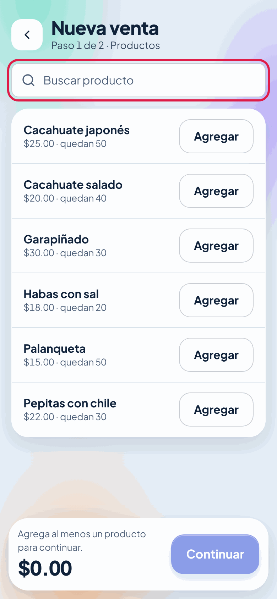

2. Toca **Agregar** en cada producto. Con **+** y **−** cambias las piezas. Abajo ves el total y cuántas piezas llevas. Cuando termines, toca **Continuar**.

   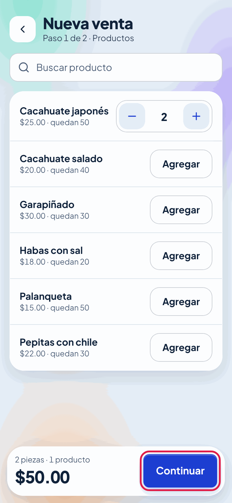

   Si un producto se agota, aparece **Agotado** y ya no puedes agregarlo.

3. En el **paso 2 de 2, Cobro**, puedes escribir un **Cliente o referencia** y una **Nota** (los dos son opcionales). Por omisión la venta se cobra **ahora, en efectivo, por el total**. Si es así, toca **Confirmar venta**.

   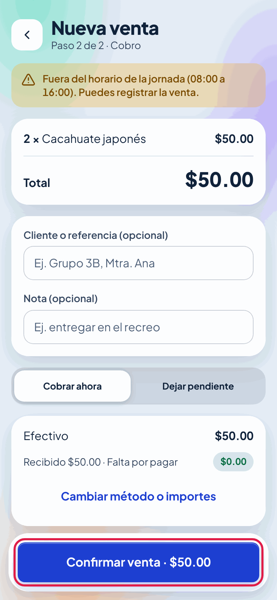

4. Al confirmar, aparece **Venta registrada** con el **folio** (por ejemplo, V-0001), el total, lo recibido y el estado. Desde ahí puedes iniciar otra **Nueva venta**, abrir **Ver detalle** o **Volver a Hoy**.

   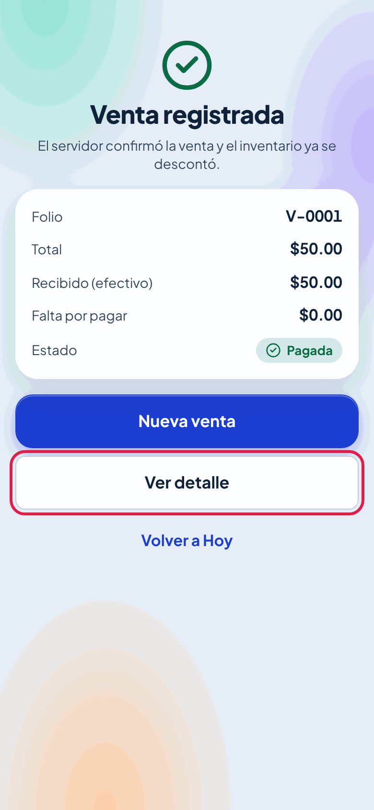

### Otras formas de cobrar

**Transferencia, o parte en efectivo y parte en transferencia.** En el paso 2 toca **Cambiar método o importes**. Elige **Efectivo**, **Transf.** o **Mixto**. En **Mixto**, escribe cuánto fue en cada método. La aplicación te dice si la suma alcanza ("La venta quedará pagada") o cuánto faltará. Toca **Usar este cobro** y después **Confirmar venta**.

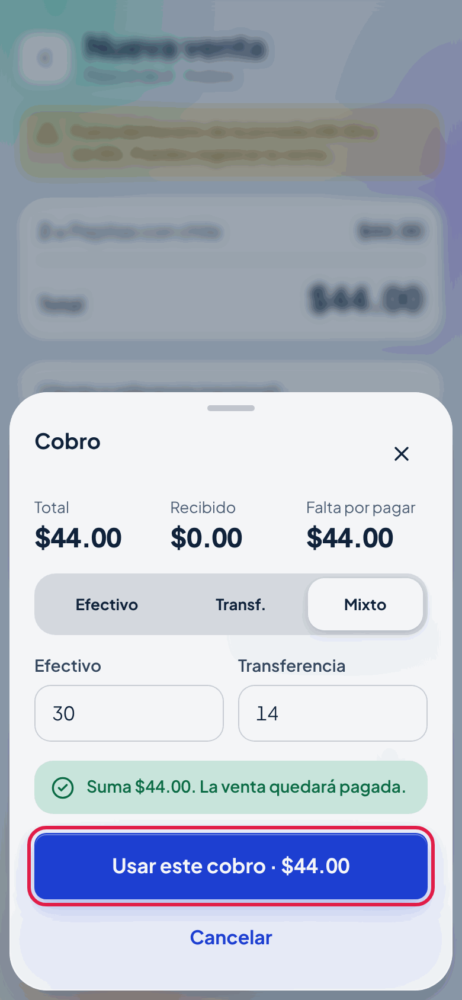

**Pago parcial.** Si te pagan solo una parte, toca **Cambiar método o importes** y escribe lo que recibiste. La aplicación te avisa cuánto faltará por pagar, y la venta queda **Pendiente** por esa diferencia.

**Dejar la venta pendiente.** Si el cliente pagará después, toca **Dejar pendiente**. La venta se registra por el total y queda por cobrar. Conviene escribir un **Cliente o referencia** para acordarte de quién es.

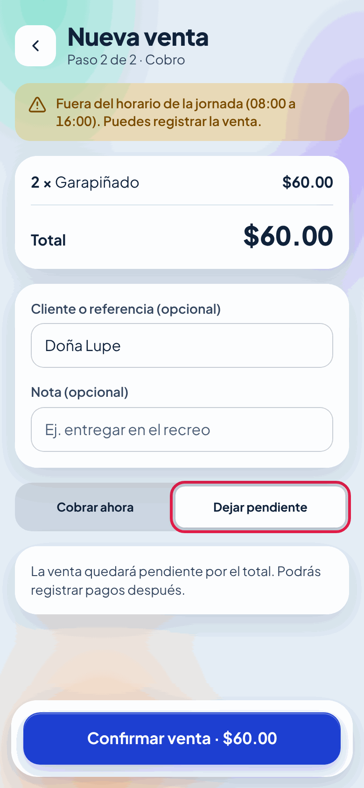

> **Importante.** Al confirmar, el inventario se descuenta de inmediato. Si mientras vendías cambió el inventario (por ejemplo, otra venta se llevó las últimas piezas), la aplicación no registra la venta, te avisa y te pide revisar las cantidades. El **precio, el costo y el nombre** que se guardan son los de ese momento: si después cambias el precio de un producto, las ventas anteriores no cambian.

### Ver el detalle de una venta

Desde **Ver detalle** (o desde cualquier venta del Historial o de Pendientes) ves los productos con los precios de ese momento, el total, lo recibido, lo que falta por pagar y el **historial de pagos**.

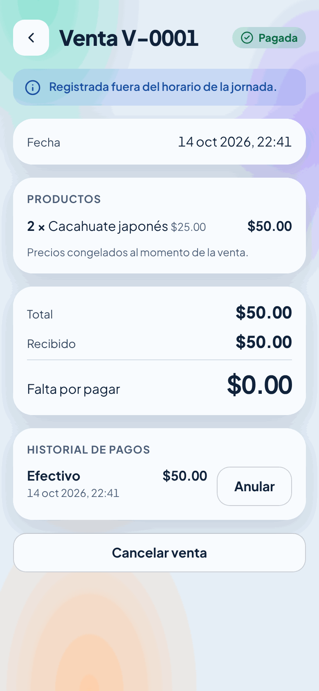

## 5. Cobrar una venta pendiente

1. Toca **Pendientes** en la barra de abajo. Arriba ves cuánto **Falta por cobrar** en total y, debajo, cada venta pendiente con su **Total**, lo **Recibido** y lo que **Falta**.

   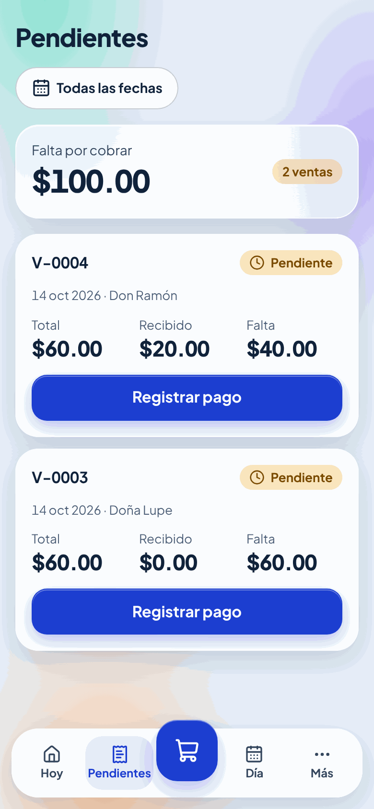

2. Si tienes muchas, toca **Todas las fechas** para filtrarlas por la fecha de venta: **Hoy**, **Ayer**, **Esta semana**, **Este mes** o un rango con **Desde** y **Hasta**. Después toca **Aplicar filtro**. **Mostrar todas** quita el filtro.

   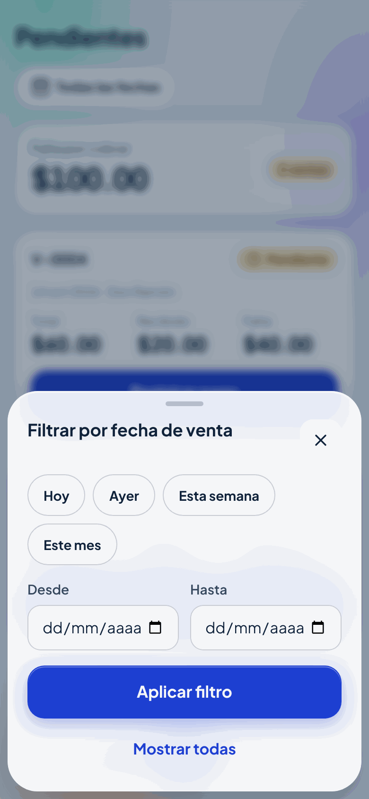

3. Toca la venta que te pagaron (o **Registrar pago** directo en su tarjeta). En el detalle toca **Registrar pago**.

   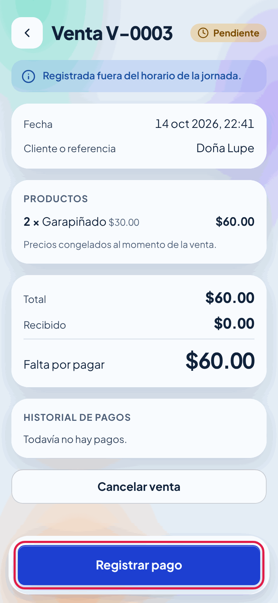

4. Elige el método (**Efectivo**, **Transf.** o **Mixto**) y revisa el importe. Por omisión trae lo que falta. Si el cliente paga menos, escribe lo recibido: la venta sigue pendiente por la diferencia. No puedes cobrar más de lo que falta. Toca **Registrar pago**.

   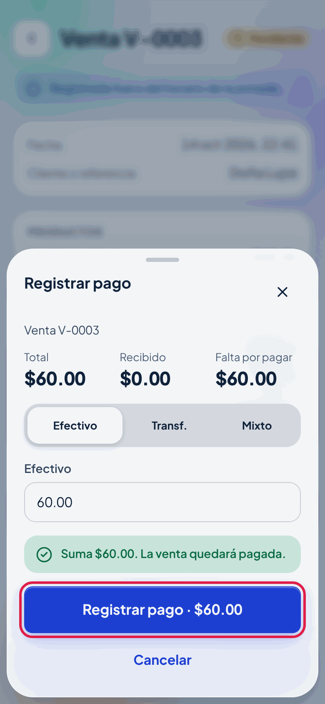

5. Cuando el saldo llega a cero, la venta pasa a **Pagada** y sale de **Pendientes**.

   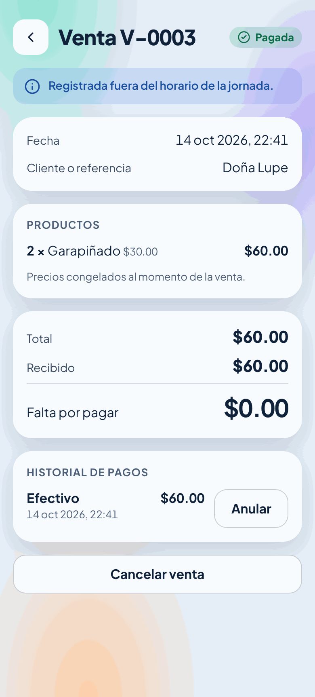

## 6. Corregir un error

En esta aplicación **nada se borra**. Las correcciones se hacen cancelando una venta o anulando un pago, siempre con un **motivo**, y todo queda registrado.

### Anular un pago

Úsalo cuando registraste un cobro con el método o el importe equivocado.

1. Abre la venta y toca **Anular** junto al pago equivocado.
2. Escribe el **Motivo** (es obligatorio) y toca **Anular pago**. La aplicación te avisa qué pasará con el saldo de la venta.

   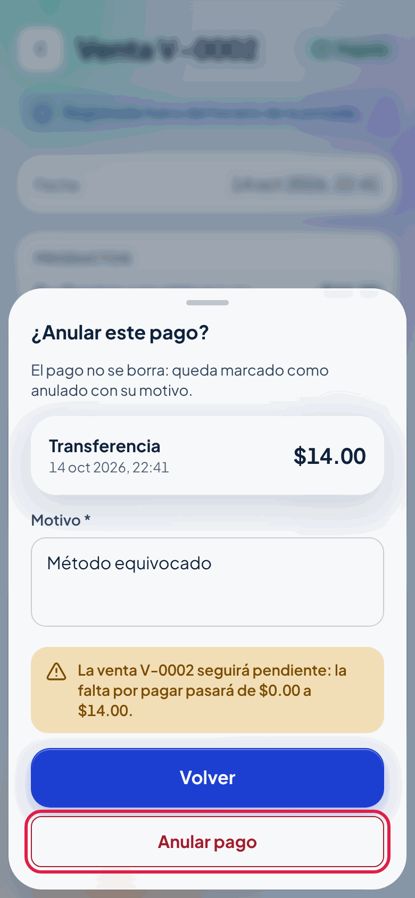

3. El pago sigue apareciendo, tachado y marcado **Anulado**, con su motivo, y la venta vuelve a mostrar lo que falta por pagar. Si hace falta, registra el pago correcto.

   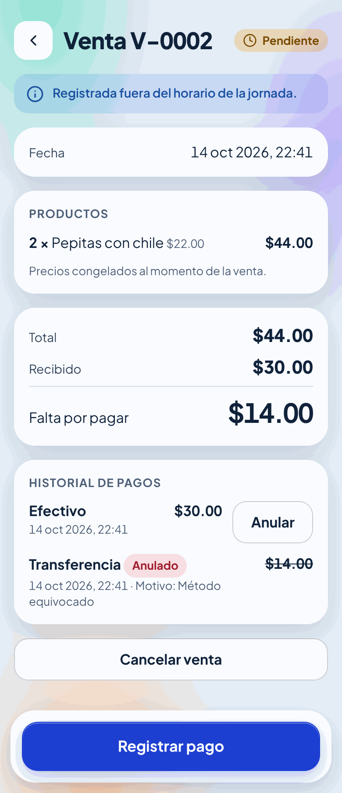

### Cancelar una venta

Úsalo cuando la venta no debió hacerse.

1. Abre la venta y toca **Cancelar venta**.
2. Escribe el **Motivo de la cancelación** (obligatorio) y toca **Cancelar venta**.

   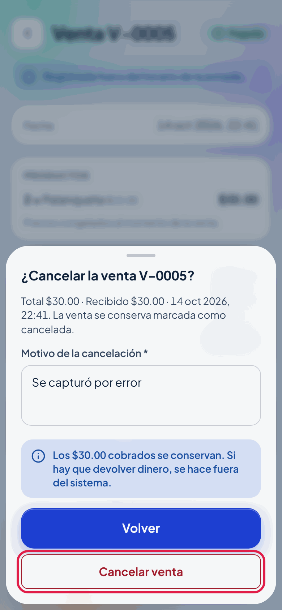

3. La venta queda como **Cancelada** y deja de contar en las ventas, el cobrado y la utilidad.

   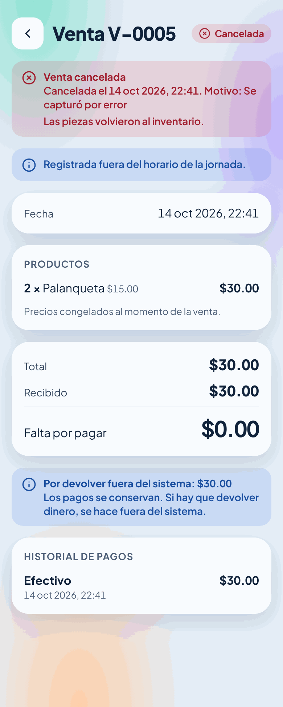

Lo que debes saber:

- **Si la venta es de hoy**, las piezas regresan al inventario.
- **Si es de un día anterior**, el inventario **no** se restituye, y la aplicación te lo advierte antes de confirmar.
- **Los pagos se conservan.** Si hay que devolverle dinero al cliente, se hace por fuera: la aplicación solo te recuerda cuánto, con el aviso **Por devolver fuera del sistema**.

## 7. Consultar tus ventas: Historial

Toca **Más** → **Historial** (los vendedores lo ven como **Mis ventas**).

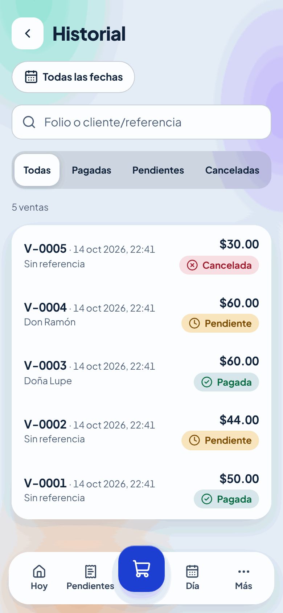

- Escribe un folio o un cliente en el buscador.
- Filtra por estado: **Todas**, **Pagadas**, **Pendientes** o **Canceladas**.

  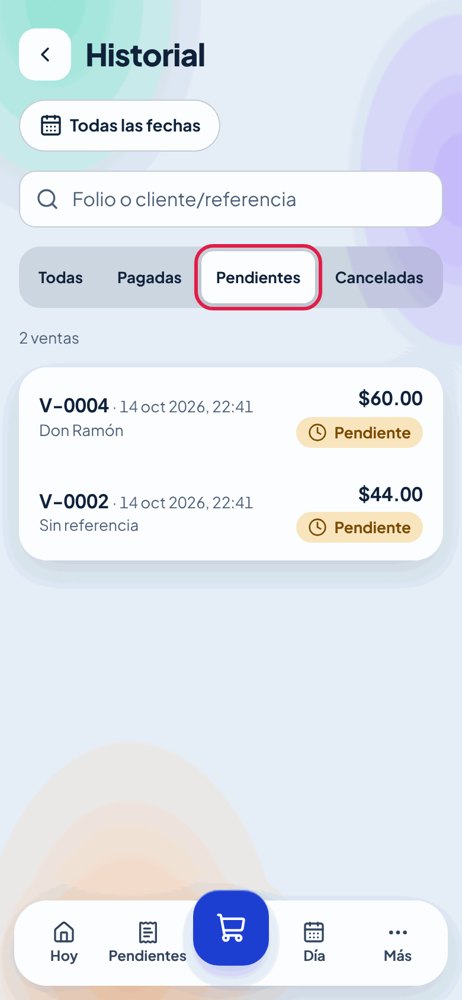

- Toca el botón de fechas (**Todas las fechas**) para limitar por periodo, igual que en Pendientes.

  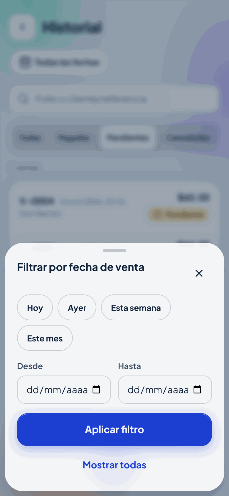

- Toca una venta para abrir su detalle.

## 8. Reportes

Toca **Más** → **Reportes** (los vendedores lo ven como **Mis reportes**). Elige el periodo: **Día**, **Semana**, **Mes** o **Rango**, y muévete con las flechas.

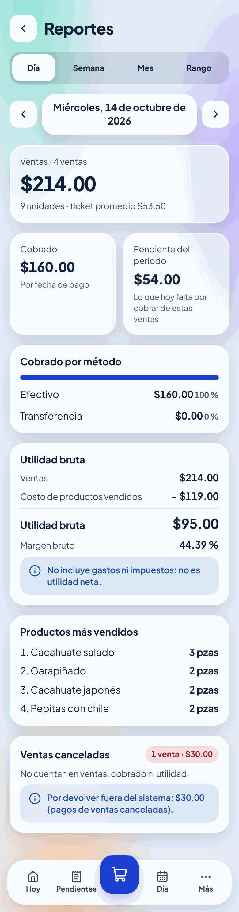

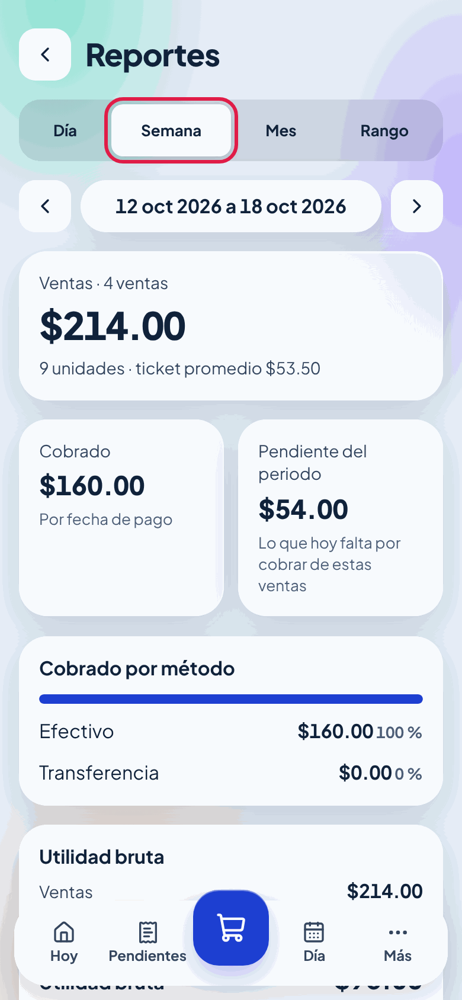

Para ver un rango de fechas elige **Rango**, escribe **Desde** y **Hasta**, y toca **Aplicar rango**. El rango no puede pasar de 366 días.

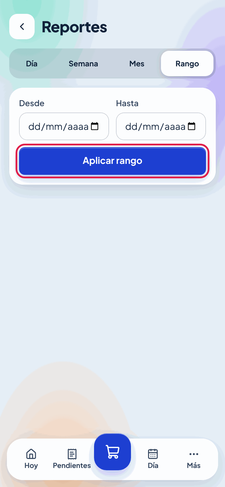

Qué significa cada número:

| Tarjeta | Qué muestra |
|---|---|
| **Ventas** | Cuántas ventas hubo, su total, las unidades vendidas y el ticket promedio. |
| **Cobrado** | El dinero recibido en el periodo, **por fecha de pago** (puede incluir cobros de ventas de días anteriores). |
| **Pendiente del periodo** | Lo que hoy todavía falta por cobrar de las ventas de ese periodo. |
| **Cobrado por método** | Cuánto fue en efectivo y cuánto en transferencia. |
| **Utilidad bruta** | Ventas menos el costo de los productos vendidos, y el **Margen bruto**. **No incluye gastos ni impuestos: no es utilidad neta.** |
| **Productos más vendidos** | Los productos que más piezas movieron. |
| **Ventas canceladas** | Cuántas se cancelaron. No cuentan en ventas, cobrado ni utilidad. |

## 9. Tu perfil y cerrar sesión

Toca el icono de persona en **Hoy**, o **Más** → **Perfil**. Ahí ves tu **Correo**, la **Tienda** y tu **Rol** (Propietario o Vendedor). Para salir, toca **Cerrar sesión**, sobre todo si usas un teléfono compartido.

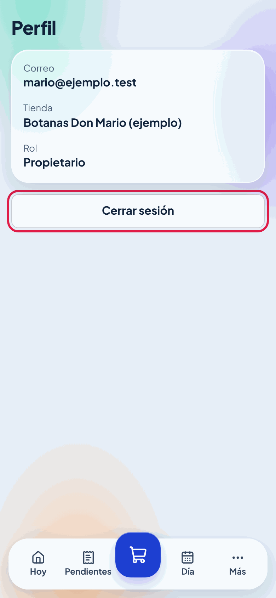

La pantalla **Más** reúne el resto de las secciones. Lo que ves depende de tu rol:

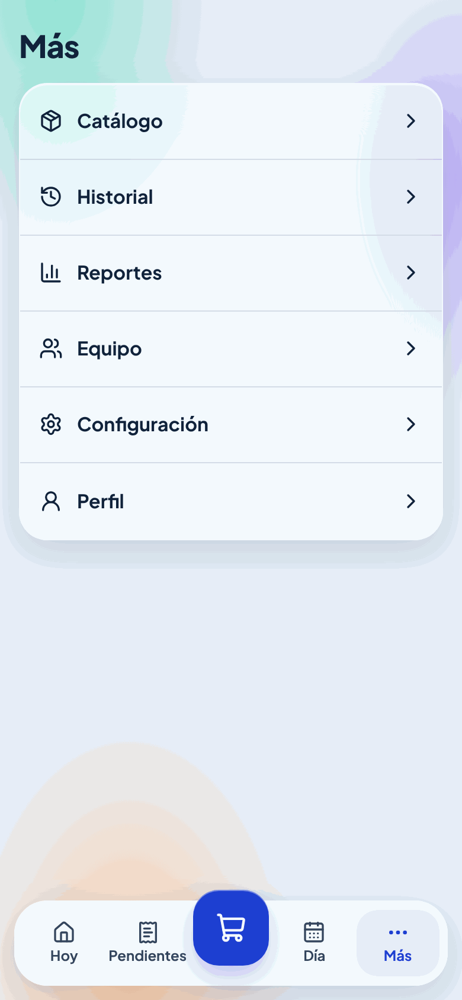

## 10. Si algo no sale como esperabas

**Sin conexión.** Aparece un aviso amarillo arriba. Mientras dure, los botones que guardan cambios se desactivan. Espera a que regrese el internet; al volver, el aviso desaparece.

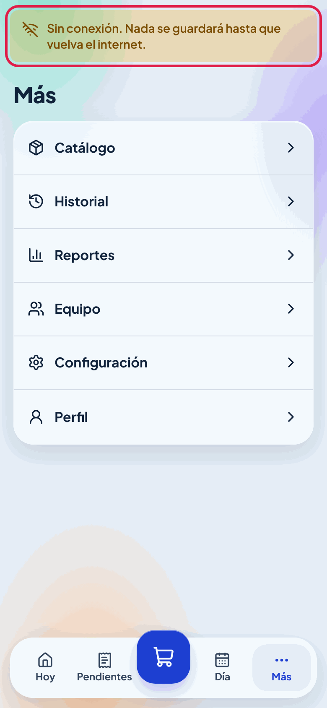

**No pudimos cargar la información.** Puede ser el internet o el servidor. Toca **Reintentar**. Si persiste, anota el **código de referencia** que aparece y avísale a quien administra la aplicación.

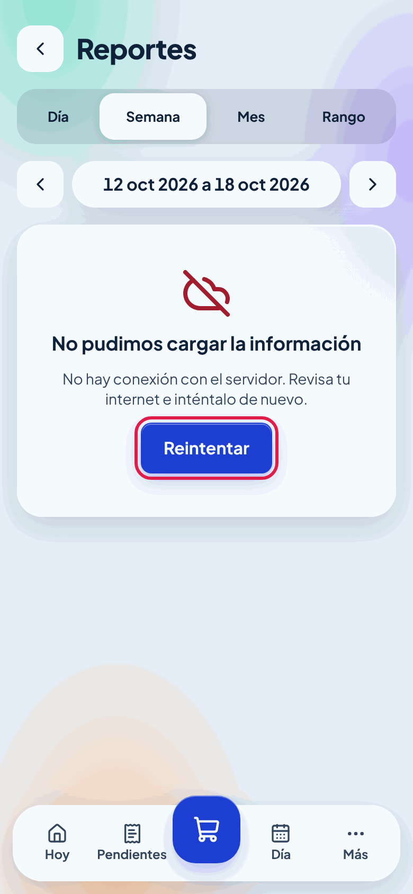

**Tu sesión expiró.** Por seguridad, la sesión se cierra tras un tiempo. Toca **Iniciar sesión**, entra de nuevo y regresarás a donde estabas. **La venta que estabas armando se conserva.**

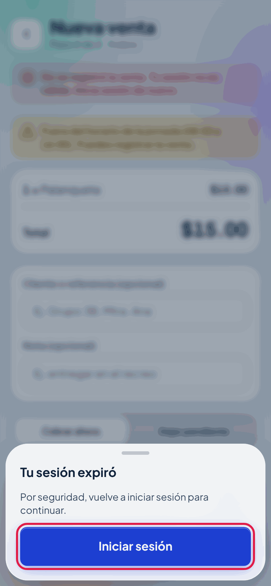

**No encontramos esta página.** La dirección está mal escrita o ya no existe. Toca **Ir al inicio**.

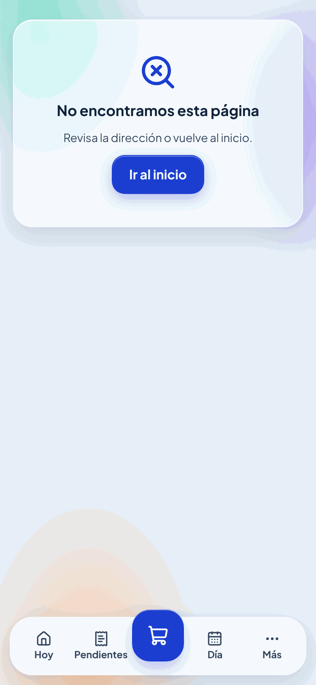

**Tu cuenta aún no tiene una tienda.** Tu correo existe, pero todavía no está asignado a ninguna tienda. Pide que te asignen una.

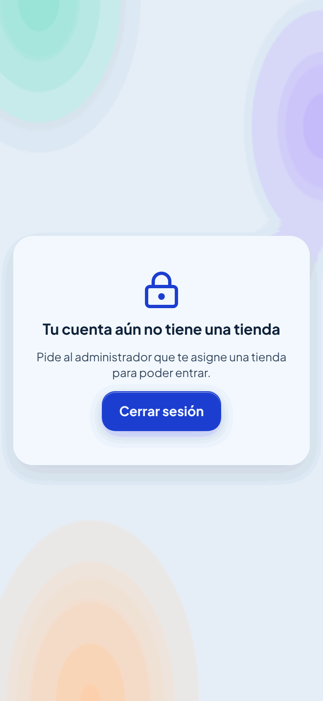

**Tu tienda está desactivada.** La tienda fue desactivada por quien la administra y no puedes usar la aplicación por ahora. Contacta a esa persona.

**Esta venta ya no está disponible.** La venta no existe o no es tuya. Un vendedor solo ve sus propias ventas.

---

# Parte 2. Guía del propietario

El propietario hace todo lo de la parte 1 y, además, administra el catálogo, la configuración de la tienda y su equipo de vendedores. También puede vender, cobrar, cancelar y consultar todo lo de la tienda.

## 11. Catálogo de productos

**Más** → **Catálogo** es la lista maestra de lo que vendes. De aquí salen los productos que tú y tus vendedores eligen al preparar el día.

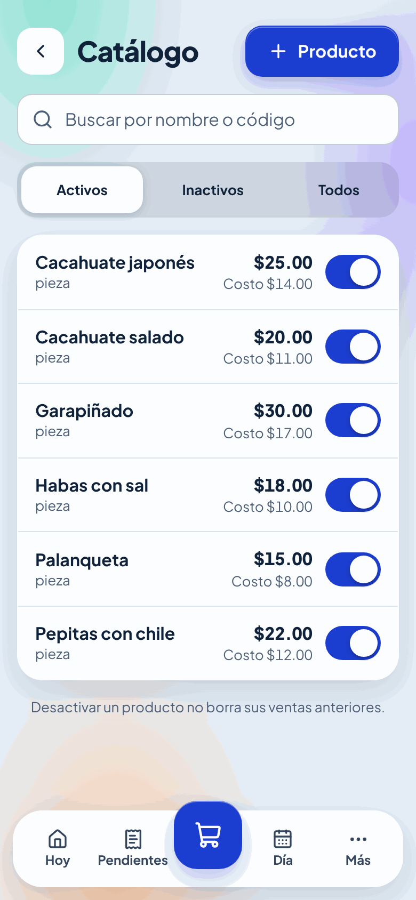

- Busca por nombre o código.
- Filtra con **Activos**, **Inactivos** o **Todos**.
- El interruptor de cada producto lo activa o lo desactiva. Un producto desactivado ya no aparece para vender, pero **sus ventas anteriores se conservan**.

### Agregar un producto

1. Toca **+ Producto**.
2. Llena los datos. Los marcados con asterisco son obligatorios:

   | Campo | Para qué sirve |
   |---|---|
   | **Nombre \*** | Cómo lo ves al vender. |
   | **Precio de venta \*** | Lo que cobras. Se congela en cada venta. |
   | **Costo \*** | Lo que te cuesta. Con él se calcula la utilidad bruta; si no lo conoces, puede ser 0. |
   | **Unidad** | Por ejemplo, pieza. |
   | **Código interno** | Opcional, para buscarlo rápido. No puede repetirse. |
   | **Categoría**, **Descripción**, **Notas** | Opcionales. |
   | **Producto activo** | Si está apagado, no se puede vender. |

   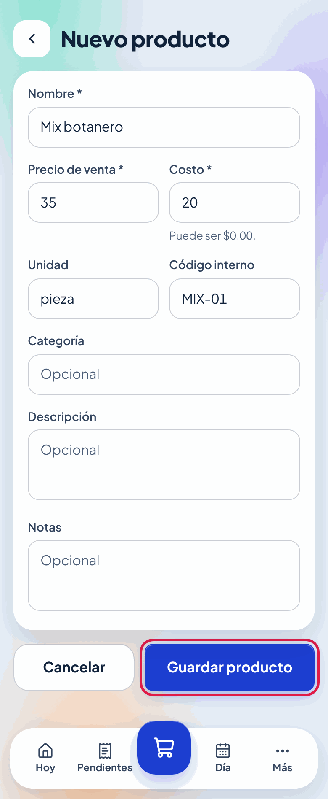

3. Toca **Guardar producto**. Aparece el aviso **Producto guardado.** y el producto ya está en el catálogo.

   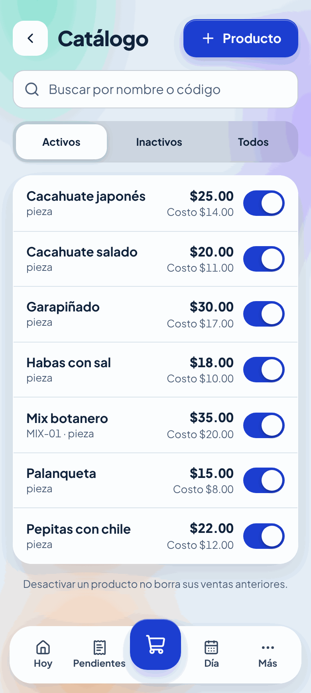

Si sales del formulario con cambios sin guardar, la aplicación pregunta **¿Salir sin guardar?** para que elijas **Seguir editando** o **Descartar cambios**.

### Editar o desactivar un producto

Toca el producto para editarlo. Si cambias el precio o el costo, **solo afecta las ventas nuevas**.

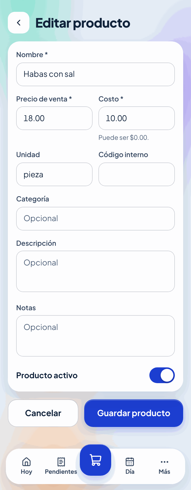

Para desactivar uno, apaga su interruptor. Lo encuentras luego en **Inactivos**, donde puedes reactivarlo.

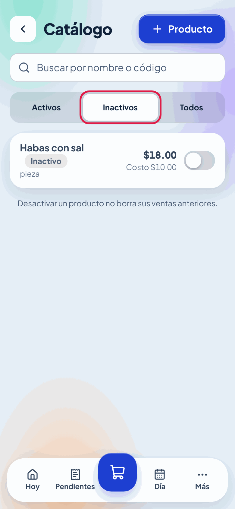

## 12. Configuración de la tienda

**Más** → **Configuración** (**Mi tienda**).

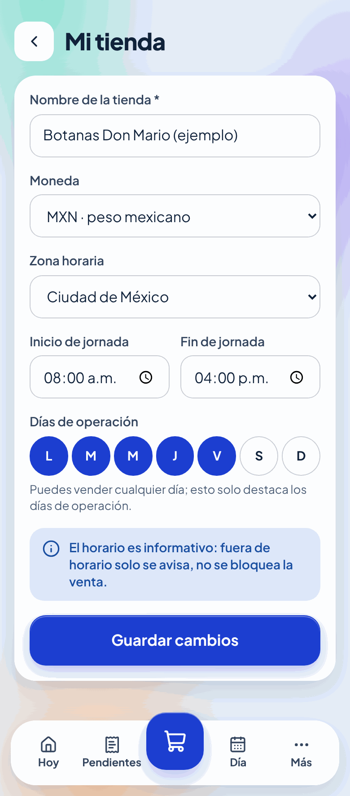

- **Nombre de la tienda**.
- **Moneda** y **Zona horaria**. De la zona horaria depende qué día es "hoy" para tu tienda.
- **Inicio de jornada** y **Fin de jornada**, y los **Días de operación**. Son solo informativos: fuera de horario o en un día que no operas, la aplicación **avisa pero no bloquea** la venta.

Toca **Guardar cambios** para aplicarlos. Esta pantalla es solo del propietario.

## 13. Equipo: tus vendedores

**Más** → **Equipo**. Aquí das de alta a las personas que venden contigo (hasta **10 vendedores activos** por tienda). Cada persona tiene su propio correo y contraseña; así cada quien ve y administra solo lo suyo.

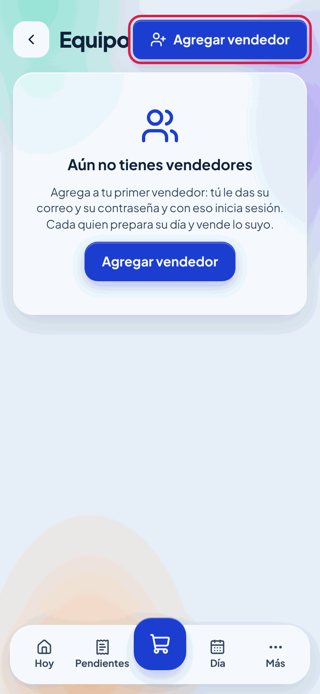

### Dar de alta a un vendedor

1. Toca **Agregar vendedor**.
2. Escribe su **Nombre**, su **Correo** y una **Contraseña**. La contraseña debe tener al menos 12 caracteres, con mayúscula, minúscula y número.

   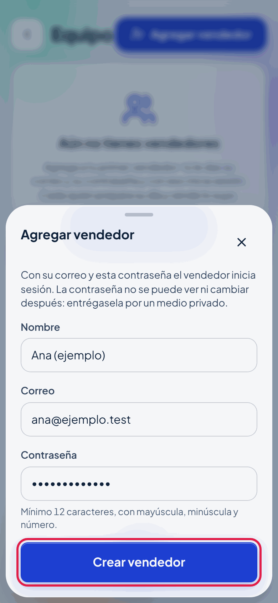

3. Toca **Crear vendedor**. Aparece el aviso de que ya puede iniciar sesión.
4. **Entrégale su correo y su contraseña por un medio privado.** Con eso inicia sesión como vendedor.

> **Importante sobre la contraseña.** La contraseña que escribes **no se puede ver ni cambiar después**, ni tú ni el vendedor desde la aplicación. Por ahora, si un vendedor la pierde, hay que pedir ayuda a quien administra la aplicación.

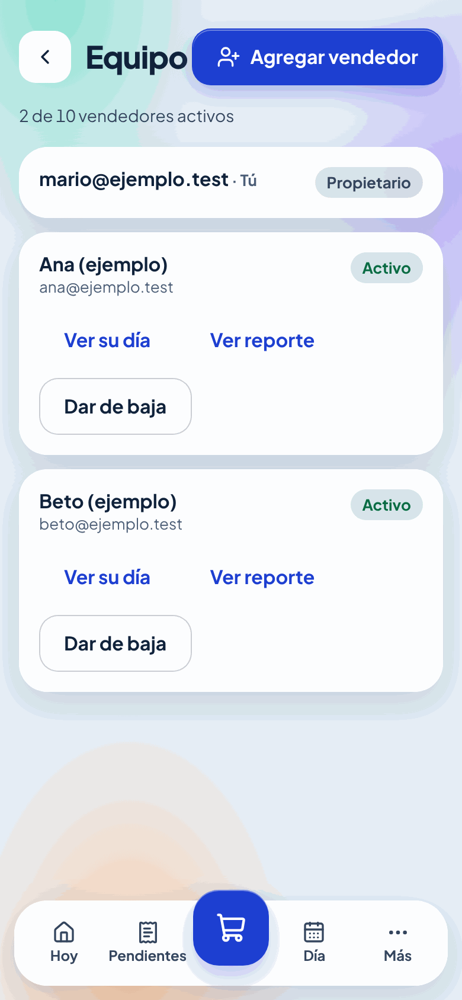

Cada vendedor aparece con su estado (**Activo** o **Dado de baja**) y estos botones:

- **Ver su día:** el inventario que preparó hoy, en modo de solo lectura.
- **Ver reporte:** su reporte de ventas y lo que te debe.
- **Dar de baja** o **Reactivar**.

### Dar de baja y reactivar

Cuando alguien deja de trabajar contigo:

1. Toca **Dar de baja** en su fila y confirma. Pierde el acceso **de inmediato**, aunque tenga la sesión abierta. Sus ventas y reportes se conservan.

   

2. Su fila queda como **Dado de baja**. Si regresa, toca **Reactivar**.

   

## 14. Ver el trabajo de tu equipo

Cuando tienes vendedores, varias pantallas suman información por persona.

**Hoy.** Aparece el bloque **Por vendedor**: lo que vendió y cobró cada persona hoy, y lo que se le debe, de cualquier día.

**Pendientes.** Además del total, ves cuánto debe cada persona. Toca a una persona para ver solo sus pendientes.

**Historial.** En el filtro de fechas aparece **Vendedor**, para ver solo las ventas de una persona.

**Reportes por vendedor.** En **Más** aparece **Reportes por vendedor** cuando ya tienes al menos un vendedor.

Muestra los totales de **toda la tienda** y, debajo, una tarjeta por persona: sus ventas, su utilidad bruta, lo cobrado y lo **por cobrar**.

Toca una persona para ver su detalle. En **Lo que se le debe** ves el total y cuánto lleva de antigüedad (hasta 7 días, de 8 a 30 días o más de 30), además de su comparación con el periodo anterior, sus ventas por día y cuánto del inventario que preparó alcanzó a vender.

**Ver el día de un vendedor.** Desde **Equipo** → **Ver su día** consultas qué productos preparó y cuánto lleva vendido. Es solo de lectura: no puedes modificar su inventario.

> **Cómo entender "lo que se le debe".** Es el dinero de las ventas pendientes de esa persona, de cualquier día: lo que sus clientes todavía no han pagado y que ella te debe entregar o cobrar.

---

# Parte 3. Guía del vendedor

El vendedor prepara su propio día con los productos que registró el propietario, vende, cobra, corrige sus propios errores y consulta lo suyo. No ve ni modifica nada de otras personas.

## 15. Lo que puedes y lo que no

| Puedes | No puedes |
|---|---|
| Preparar tu día con los productos del propietario y las cantidades que tengas. | Crear, editar ni desactivar productos. |
| Vender y cobrar. | Cambiar la configuración de la tienda ni el horario. |
| Registrar pagos de tus ventas pendientes. | Ver las ventas, pagos o el inventario de otra persona. |
| Cancelar **tus** ventas y anular **tus** pagos, con motivo. | Ver el equipo ni dar de alta o de baja a nadie. |
| Ver **Mis ventas** y **Mis reportes**, incluida tu utilidad bruta. | Cambiar tu contraseña (por ahora). |

Tu menú **Más** es corto:

Si escribes una dirección que no te corresponde, la aplicación te regresa a **Hoy** con el aviso **No tienes acceso a esa pantalla.**

## 16. Tu día de trabajo

Inicia sesión como en la sección 1. Tu pantalla **Hoy** muestra **solo lo tuyo**. Al empezar, te pide preparar tu día.

1. **Prepara tu día.** Toca **Preparar día** (o **Día**) y **Agregar producto**. Verás todos los productos que registró el propietario. Elige cada uno que vayas a vender y escribe con cuántas piezas cuentas.

   

   Cada vendedor prepara **su propio** inventario: lo que tú agregues no afecta a nadie más. Para aumentar o quitar, usa **Aumentar** y **Quitar**, igual que en la sección 3.

   

2. **Vende y cobra** como se explica en las secciones 4 y 5: **Nueva venta**, **Cobrar ahora** o **Dejar pendiente**, y después **Registrar pago** cuando te paguen.
3. **Corrige tus errores.** Puedes cancelar una venta tuya y anular un pago tuyo, con motivo (sección 6).

## 17. Consultar lo tuyo

**Más** → **Mis ventas** muestra el historial de **tus** ventas, con los mismos filtros de la sección 7.

**Más** → **Mis reportes** muestra tus números del día, la semana, el mes o un rango (sección 8). Incluye tu **utilidad bruta**, calculada con los precios y costos que definió el propietario.

El **Pendiente del periodo** es el dinero de tus ventas que todavía no cobras. El propietario ve esa misma cifra en sus reportes por vendedor.

## 18. Si tu cuenta es dada de baja

Si el propietario te da de baja, en tu siguiente toque ves esta pantalla y ya no puedes usar la tienda. Si crees que es un error, habla con el propietario.

---

# Glosario

| Término | Significado |
|---|---|
| **Folio** | El número de una venta, por ejemplo V-0001. Es único dentro de tu tienda. |
| **Preparar el día** | Registrar qué productos tienes hoy y cuántas piezas de cada uno. |
| **Jornada** | El día de trabajo. Tiene un horario, pero solo informativo. |
| **Disponible** | Lo que queda de un producto en el día: inicial menos vendido. |
| **Pendiente** | Venta que todavía no está pagada por completo. |
| **Cobrado** | Dinero efectivamente recibido, contado por la fecha en que se recibió. |
| **Anulado** | Un pago que se corrigió: sigue visible, pero ya no cuenta. |
| **Cancelada** | Una venta que se dejó sin efecto: sigue visible, pero ya no cuenta. |
| **Utilidad bruta** | Ventas menos el costo de los productos vendidos. No incluye gastos ni impuestos, así que **no** es la utilidad neta. |
| **Margen bruto** | La utilidad bruta como porcentaje de las ventas. |
| **Por devolver fuera del sistema** | Dinero de una venta cancelada que ya se había cobrado y que se devuelve por fuera de la aplicación. |
| **Dado de baja** | Una persona del equipo que ya no puede entrar. Sus ventas se conservan. |
